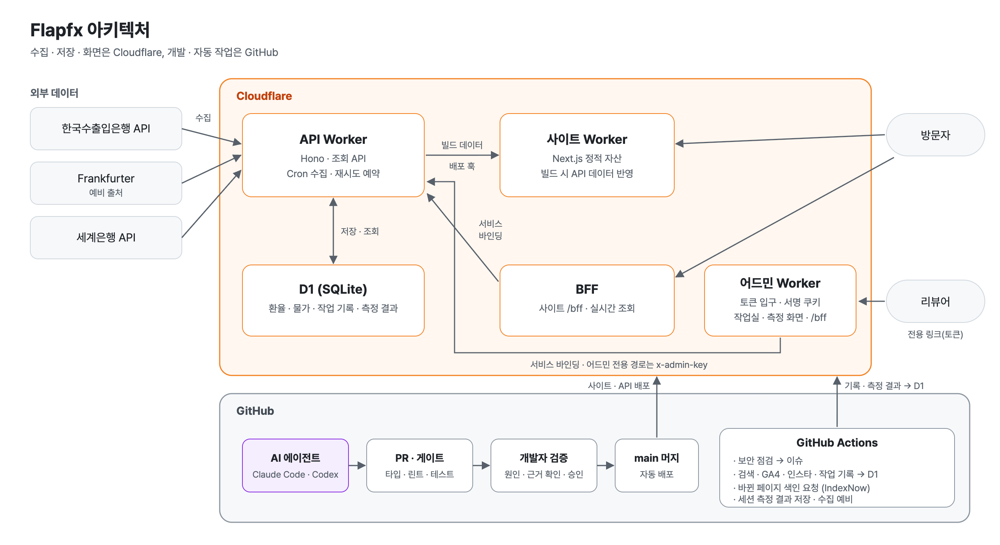

<div align="center">

# tripfx

**여행 · 직구 전에, 오늘 환율이 싼 편인지 한눈에 보는 사이트**

[사이트](https://tripfx.pages.dev) · [작업실](https://tripfx.pages.dev/log) · [GEO 측정](https://tripfx.pages.dev/geo) · [Figma 디자인](https://www.figma.com/design/ssKUqcVolukUjz3paXjxg2)


</div>

---

## 무엇을 만들었나

- 환율 · 여행 물가 · 직구 세금을 한곳에서 보는 사이트입니다. 로그인 없이 씁니다.
- 홈은 세 가지를 위에서 아래로 보여 줍니다.
  - 여행 타이밍: 통계청 국제항공료 지수로 보는 가장 싼 달
  - 오늘 환율: 이번 주 가장 싸게 갈 수 있는 곳
  - 도착지별 환전 타이밍: 최근 90일 안에서 오늘 값의 위치
- 그 밖의 화면은 통화별 환율, 여행 물가와 하루 예산, 직구 계산(면세 한도 · 관세 · 부가세), 작업실, GEO 측정, 소개입니다.
- 받지 못한 값은 지어내지 않고 "자료 없음"으로 표시합니다.

## 왜 만들었나

- 환전 · 직구 전에 "지금이 평소보다 싼가"를 바로 알고 싶었습니다.
- AI 에이전트 팀이 서비스를 만들고 운영하는 과정을 실제 기록으로 남기고 싶었습니다.
- 검색과 AI 답변에 사이트가 노출되는지를 단계별로 직접 측정하고 싶었습니다.

## 어떻게 만들었나

### 연동한 공공 자료
- 한국수출입은행 현재환율: 평일 12:00에 받고, 실패하면 13:30 · 15:00에 다시 받습니다.
- 관세청 과세환율: 주 1회, 이미 받은 주는 건너뜁니다.
- 통계청 소비자물가(국제항공료 · 해외단체여행비)와 한국은행 수입물가지수: 매달 최근 24개월을 다시 받습니다.
- 세계은행 나라별 물가 수준: 처음 고른 지표가 API에서 빠져 계산식을 바꿨습니다.
- 응답은 형식을 검사해 받습니다. 짐바브웨 물가 0.0003 같은 원본 오류를 이 단계에서 걸렀습니다.
- 예비 출처(Frankfurter)는 공식 값을 덮지 않습니다.

### 구조
- web: Next.js 16 정적 사이트(Cloudflare Pages)
- api: Hono(Cloudflare Workers) · D1 · Drizzle · 예약 실행
- ui: 디자인 시스템과 3D, shared: 공용 타입과 형식 검사 스키마
- 흐름: 예약 수집 → 형식 검사 → D1 저장 → 새 값이면 사이트 다시 빌드 → 빌드 때 API에서 받아 정적 페이지 생성
- 화면은 같은 주소의 `/bff` 경로로만 API를 부르고, 읽기 경로만 열려 있습니다.



### AI 에이전트 팀 개발 방식
- 역할을 나눕니다: 계획 · 통합(lead), 구현(builder), 테스트 먼저 작성(test), 검색 노출 측정(geo).
- 모든 작업의 요청 원문을 그대로 보관합니다.
- 완료의 기준은 자동 검사 통과(타입 · 린트 · 테스트, 큰 변경은 빌드 · e2e 추가)이고, 머지는 사람이 합니다.
- 사람 승인 없이 바꿀 수 없는 파일 목록이 있고, 승인 라벨이 있어야 검사를 통과합니다.
- 작업마다 허점을 기록하고, 반복된 허점은 테스트로 막습니다.
- 첫 커밋은 2026-10-28입니다.
- 과정은 [작업실](https://tripfx.pages.dev/log)에 실시간으로 공개합니다.

### 실제 사고와 해결
- 2026년 10월 29일 데이터베이스 하루 읽기 한도(500만 줄)를 넘어 API가 오류를 냈습니다.
  - 원인은 기본 키 순서였고 한 통화 1년 조회가 5,400줄을 읽었습니다.
  - (통화, 날짜) 색인으로 약 245줄로 줄이고 응답 캐시를 더했습니다.
- 수출입은행 연결 오류로 영업일 4일 동안 예비 값만 저장됐지만 화면은 정상처럼 보였습니다.
  - 예비 값을 "오늘 값 있음"으로 봐 재시도를 건너뛴 것이 원인이었습니다.
  - "공식 값이 있는가"로 재시도를 판단하고, 예비 값만 있으면 상태판이 경고를 냅니다.
- 금요일마다 예약 수집이 돌지 않았습니다. 요일 숫자 1이 일요일이라 일~목에 돌았습니다. 요일을 이름으로 쓰고 숫자 요일을 막는 테스트를 더했습니다.
- 인증키가 저장소 설정에만 있고 수집은 Worker에서 돌았습니다. 배포 때 키를 Worker에 넣도록 했고 값은 로그에 남기지 않습니다.

### 검색 · AI 답변 노출 측정
- 질문 24개(브랜드 8 · 일반 16)를 직접 검색해 노출 · 인용을 기록합니다.
- 측정한 회차 모두 노출 0 · 인용 0입니다.
- 구글 검색 노출은 3회, 클릭은 0회입니다.
- 사이트맵 29개 주소는 모두 정상인데 구글 상태는 "가져올 수 없음"입니다. 원인은 조사 중입니다.
- 결과는 [GEO 측정](https://tripfx.pages.dev/geo) 페이지에 그대로 공개합니다.


## 기술 스택

- 사이트: Next.js 16 · React · TypeScript · Tailwind CSS · three.js
- API: Hono · Cloudflare Workers · Zod
- 데이터: Cloudflare D1 · Drizzle ORM
- 배포 · 자동화: Cloudflare Pages · Pages Functions · GitHub Actions · Turborepo
- 검증: Vitest · Playwright
- AI 에이전트: Claude Code · Codex
- 글꼴: Gasoek One · IBM Plex Sans KR

## 폴더 구조

```text
apps/web        사이트 (Next.js 정적 내보내기)
apps/api        API (Hono · Workers · D1 · Drizzle)
packages/ui     디자인 시스템 · 3D
packages/shared 공용 타입 · 형식 검사 스키마
functions/bff   같은 주소의 /bff/*
docs            구조 · 디자인 · 기능별 규칙
.agents         자동 검사 · 보호 파일 목록 · 작업 폴더
```

## 주소

- 사이트: https://tripfx.pages.dev
- 작업실: https://tripfx.pages.dev/log
- GEO 측정: https://tripfx.pages.dev/geo
- Figma: https://www.figma.com/design/ssKUqcVolukUjz3paXjxg2

<div align="center">

MIT License

</div>
