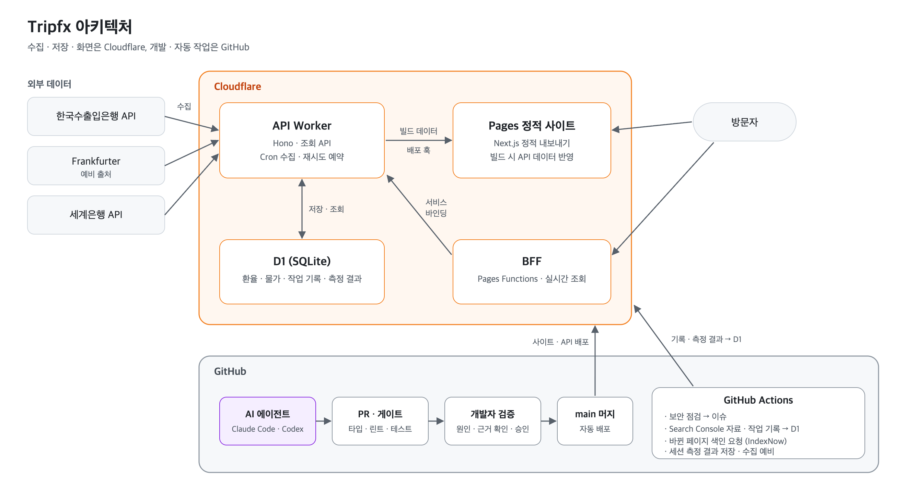
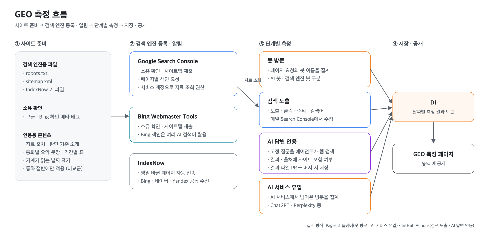

<div align="center">

# 💱 Tripfx

**AI 코딩 에이전트를 활용한 서비스 개발 · 운영 학습 프로젝트**

개인 프로젝트 · 기획 · 설계 · 검증 담당 (구현 · 운영은 AI 에이전트) · 2026.10 ~

[🌐 tripfx.pages.dev](https://tripfx.pages.dev) · [🛠️ 작업실](https://tripfx.pages.dev/log) · [📡 GEO 측정](https://tripfx.pages.dev/geo)

<br>


<br><br>

한국수출입은행 · 세계은행 공개 데이터를 바탕으로 환율, 국가별 물가 수준, 직구 예상 세액을 제공하는 대시보드입니다.<br>
개발자는 기획 · 설계 · 검증을 담당하고, 구현 · 테스트 · 배포 · 운영 점검은 AI 코딩 에이전트(Claude Code · Codex)가 수행합니다.<br>
에이전트의 작업 과정, 오류, 장애 대응 기록은 작업실 페이지에 공개합니다.

<br>

<table>
  <tr>
    <td></td>
    <td></td>
  </tr>
</table>

</div>

---

## 학습 주제

**🤖 에이전트 하네스** — 에이전트의 작업 완료 판정과 반복 오류를 검사 도구로 관리하는 방법을 학습했습니다.

**🧱 도메인 경계 · 컨텍스트 설계** — 기능 경계를 정의하고, 에이전트에게 맥락을 전달하는 구조를 설계했습니다.

**🔧 운영 · 장애 대응** — 운영 중 발생한 장애의 원인을 분석하고, 근거를 검토한 뒤 조치를 승인했습니다.

**⏱️ 예약 작업 설계** — 플랫폼별 동작 차이와 예약 실행 지연이 수집 · 배포에 미치는 영향을 검토했습니다.

**📡 GEO 실험** — 사이트의 검색 엔진 · AI 검색 노출 여부를 측정하는 방법을 설계하고 실험하고 있습니다.

아래 세부 내용은 위 주제와 같은 순서로 구성했습니다.

---

## 세부 내용

<details>
<summary><b>🤖 에이전트 하네스</b> — 완료 판정을 검사 도구에 맡기고, 반복 오류를 자동 검사로 전환</summary>

<br>

**배경** — 에이전트가 검증 없이 작업 완료를 보고하거나, 지시문에 명시한 규칙을 반복해서 위반하는 사례가 있었습니다.

**과정**
- 타입 검사 · 린트 · 테스트 · 보호 파일 · 작업 범위를 확인하는 게이트를 적용하고, 게이트 통과를 완료 조건으로 정의했습니다.
- 규칙 · 배포 설정 · 데이터 계약을 보호 파일로 지정하고, 개발자 승인 없이는 CI를 통과하지 않도록 했습니다.
- 응답 언어 규칙 위반과 작업 범위 밖 파일 쓰기는 훅으로 검사하도록 했습니다.
- 테스트는 통과했지만 실행 환경에서 동작하지 않은 스크립트 사례를 계기로, 스크립트가 타입 검사 대상에 포함되도록 했습니다.

**학습 내용**
- 반복되는 오류는 지시문 보완보다 자동 검사로 전환하는 방식이 재발 방지에 효과적이었습니다.
- 경계 테스트로 에이전트의 잘못된 파일 배치가 머지 전에 확인됐습니다.
- 소규모 수정에도 작업 기록과 게이트 절차가 필요해, 작업 속도가 저하되는 비용이 있었습니다.

</details>

<details>
<summary><b>🧱 도메인 경계 · 컨텍스트 설계</b> — 기능 단위 분리와 규칙 원본 관리, 요청 원문 전달 방식 적용</summary>

<br>

**배경** — 에이전트는 세션마다 맥락을 새로 파악해야 하며, 문서로만 정의한 기능 경계는 유지되지 않는 경우가 있었습니다.

**과정**
- 기능별 슬라이스(`features/<기능>/`)로 코드를 분리하고, 슬라이스 간 직접 참조를 금지했습니다.
- 업무 규칙은 `docs/domain/`에서 단일 원본으로 관리하고, 코드와 테스트는 규칙 ID로만 참조하도록 했습니다.
- 에이전트의 진입점을 50줄 이내의 `AGENTS.md`로 제한하고, 상세 문서는 링크로 연결했습니다.
- 작업별 요청 원문을 요약 없이 작업 폴더에 보관해, 이후 세션이 동일한 원문을 기준으로 작업을 이어 가도록 했습니다.

**학습 내용**
- 경계 규칙은 테스트와 린트로 강제할 때 유지됐습니다.
- 요청을 요약해서 전달하면 의도가 누락될 수 있어, 원문 전달을 원칙으로 정했습니다.

</details>

<details>
<summary><b>🔧 운영 · 장애 대응</b> — 화면상 정상으로 표시되던 장애 사례 분석과 점검 · 경고 방식 검토</summary>

<br>

**배경** — 수출입은행 데이터 수집이 실패해 영업일 4일간 예비 출처 데이터로 운영됐지만, 화면이 정상으로 표시돼 인지가 늦어졌습니다.

**과정**
- 코드 변경, 인증서, 플랫폼, 네트워크 경로 순으로 가설을 검증해 원인 범위를 좁혔습니다.
- 근본 원인(HTTP 525)은 은행 서버 로그를 확인할 수 없어 확정하지 못했고, 공식 데이터가 없으면 재시도하는 방어 로직을 적용했습니다.
- 상태 점검판이 예비 데이터만 있는 경우에도 정상으로 판정하는 문제를 확인하고, 해당 상태가 경고로 표시되도록 수정했습니다.
- AI 답변 측정 작업이 모든 질문에서 실패했는데도 성공으로 기록되는 문제를 확인하고, 실패 사유가 기록되도록 수정했습니다.

**학습 내용**
- 작업 실행 여부와 결과의 정상 여부는 별도로 확인해야 했습니다.
- 근본 원인이 확정되지 않은 상황에서도 영향 범위를 줄이는 방어 로직을 먼저 적용할 수 있었습니다.

</details>

<details>
<summary><b>⏱️ 예약 작업 설계</b> — 요일 해석 차이와 예약 실행 지연에 따른 수집 누락 사례 검토</summary>

<br>

**배경** — 지정한 시각에 실행돼야 할 예약 작업이 누락되거나 몇 시간씩 지연돼 실행되는 사례가 있었습니다.

**과정**
- Cloudflare Cron이 요일 숫자 1을 일요일로 해석해 금요일 수집이 누락된 사례를 확인하고, 요일을 이름으로 표기하도록 변경했으며 숫자 표기를 금지하는 테스트를 추가했습니다.
- 배포 직후 예약 실행이 누락되는 경우에 대비해 재시도 예약을 추가하고, 예약 직전에는 배포가 지연되도록 했습니다.
- GitHub Actions 예약이 다음 날로 지연돼 전날 변경된 페이지의 색인 요청이 누락된 사례를 확인하고, 전송 범위를 전날까지 확대했습니다.

**학습 내용**
- 동일한 설정도 플랫폼마다 해석이 다를 수 있어, 실제 동작을 테스트로 고정할 필요가 있었습니다.
- 날짜와 시각에 의존하는 로직은 실행 지연과 누락을 전제로 설계해야 했습니다.

</details>

<details>
<summary><b>📡 GEO 실험</b> — 등록 · 색인 · 노출 · 인용 단계별 측정 방법 설계 (진행 중)</summary>

<br>

**배경** — 검색 엔진에 등록한 뒤에도 검색 결과와 AI 답변에 사이트가 노출되지 않았습니다.

**과정**
- 봇 방문, 검색 노출, AI 답변 인용, AI 서비스 유입의 단계로 나눠 측정하고, 측정 결과를 페이지로 공개했습니다.
- 자료 출처와 판단 기준 명시, 요약 문장 · 기간별 표 추가, 변경 페이지 색인 요청 자동화를 적용했습니다.
- 요약 문장과 표는 통화의 절반에만 적용해, 적용 여부에 따른 차이를 비교할 수 있도록 했습니다.
- AI 검색 API 측정이 비용 문제로 중단된 뒤, 에이전트 세션이 직접 검색하고 결과를 PR로 기록하는 방식으로 변경했습니다.

**학습 내용**
- 등록, 색인, 노출, 인용은 서로 다른 단계여서 각각 측정해야 했습니다.
- 측정 방법은 비용을 포함해 지속 가능성을 고려해야 했습니다.
- 현재 노출 초기 단계이며, 미노출 원인을 조사하고 있습니다.

</details>

---

## 🏗️ 아키텍처

- **API (Cloudflare Workers)** — 환율 · 물가 수집 예약, 조회 API, D1 저장을 담당합니다
- **사이트 (Cloudflare Pages)** — 빌드할 때 API 데이터를 받아 정적 페이지를 생성하고, 새 환율이 저장되면 다시 빌드됩니다
- **BFF (Pages Functions)** — 작업실의 실시간 조회를 같은 주소의 `/bff`로 받고, 서비스 바인딩으로 API를 호출합니다
- **GitHub** — 에이전트 작업이 PR · 게이트 · 개발자 검증을 거쳐 머지되고, Actions가 보안 점검 · 검색 자료 수집 · 색인 요청을 수행합니다



---

## 📡 GEO 측정 흐름

- **사이트 준비** — robots.txt · sitemap.xml · IndexNow 키 파일, 구글 · Bing 소유 확인 태그, 인용용 콘텐츠(통화 절반만 적용한 비교군 포함)
- **검색 엔진 등록 · 알림** — Google Search Console · Bing Webmaster Tools에 등록하고, 평일마다 바뀐 페이지를 IndexNow로 전송
- **단계별 측정** — 봇 방문, 검색 노출, AI 답변 인용, AI 서비스 유입을 나눠 측정
- **저장 · 공개** — 측정 결과를 D1에 날짜별로 보관하고 [GEO 측정 페이지](https://tripfx.pages.dev/geo)에 공개



---

## ⚖️ 기술 선택과 비용 검토

| 결정 | 비교 | 선택 |
| --- | --- | --- |
| 화면 렌더링 | Workers SSR vs Pages 정적 생성 + BFF | 정적 생성 + BFF |
| 데이터베이스 | PostgreSQL vs D1(SQLite) + Drizzle | D1 + Drizzle |
| 브라우저의 API 호출 | API 직접 호출 vs 같은 주소의 BFF | BFF (서비스 바인딩) |
| 환율 수집 실행 | GitHub Actions 예약 vs Worker Cron | Worker Cron · Actions는 예비 |
| 작업 기록 수집 | Pages 빌드 중 GitHub API 호출 vs Actions가 D1에 저장 | Actions → D1 |
| AI 답변 측정 | AI 검색 API 자동 측정 vs 에이전트 세션 직접 검색 | 세션 측정 |
| 주소 | 개인 도메인 vs Cloudflare 무료 주소 | 무료 주소 |

> **렌더링 · 주소** — 데이터가 하루 한 번 바뀌는 서비스여서 정적 생성으로 충분했습니다. SSR로 전환하면 Workers로 옮겨 주소가 바뀌기 때문에, 무료 주소와 정적 화면을 유지하고 실시간 조회가 필요한 작업실만 BFF로 처리했습니다. 도메인은 구입 후 연결만 변경하면 되도록 했습니다.

> **D1 읽기 한도** — 무료 요금제의 하루 읽기 한도를 사이트 빌드 반복으로 초과해, API가 오류를 반환한 사례가 있었습니다. 기본 키 순서(날짜, 통화) 때문에 한 통화를 조회해도 전체를 읽는 구조였고, (통화, 날짜) 색인을 추가했습니다. 이후 API 응답 캐시를 적용하고 빌드 횟수를 관리했습니다.

> **예약 실행 위치** — GitHub Actions 예약은 몇 시간씩 지연될 수 있어, 정시 수집은 Worker Cron이 맡고 Actions는 예비 실행만 맡도록 했습니다. 작업 기록 수집은 Pages 빌드 서버의 IP 공유로 GitHub API가 403을 반환해, Actions가 D1에 저장하는 방식으로 변경했습니다.

> **AI 답변 측정 비용** — 고정 질문 24개를 매일 AI 검색 API로 측정하는 방식은 질문 수만큼 사용료가 발생했고, 크레딧 소진 후 측정이 중단됐습니다. 추가 비용이 없는 에이전트 세션 측정으로 전환했습니다.

---

## 🧰 기술 스택

| 영역 | 기술 |
| --- | --- |
| 사이트 | Next.js 16 (정적 내보내기) · React · TypeScript · Tailwind CSS · three.js |
| API | Hono · Cloudflare Workers · Zod |
| 데이터 | Cloudflare D1 · Drizzle ORM |
| 배포 · 자동화 | Cloudflare Pages · Pages Functions · GitHub Actions · Turborepo |
| 검증 | Vitest · Playwright |
| AI 에이전트 | Claude Code · Codex |

---

## 폴더 구조

```text
apps/web        사이트 (Next.js 정적 내보내기)
apps/api        API (Hono · Workers · D1 · Drizzle)
packages/ui     디자인 시스템 · 3D
packages/shared 공용 타입 · zod 스키마
functions/bff   동일 주소의 /bff/*
docs            구조 · 디자인 · 기능별 규칙
.agents         게이트 · 보호 파일 목록 · 작업 폴더
```

<div align="center">

MIT License

</div>
