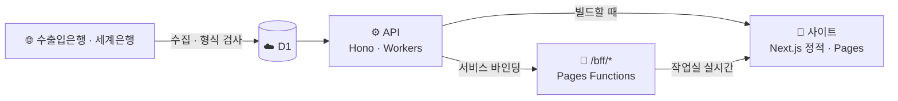

<div align="center">

# 💱 Tripfx

**오늘 환율 · 여행지 물가 · 직구 세금을 한곳에서**

[**사이트 열기**](https://tripfx.pages.dev) · [판단 기준](https://tripfx.pages.dev/about) · [작업실](https://tripfx.pages.dev/log)


</div>

## 🙋 무엇인가

여행 가기 전 **언제 환전할지**, **그 나라 물가가 어느 정도인지**, 해외 직구할 때 **원화로 얼마이고 세금이 붙는지**를 공개 데이터로 보여 줍니다. 로그인 없이 바로 쓸 수 있습니다.

## 🎯 이 프로젝트의 핵심

Tripfx는 환율 사이트이면서 하나의 실험입니다. **사람은 무엇을 만들지와 지켜야 할 규칙만 정하고, 만들고 고치고 운영하는 일은 AI 코딩 에이전트가 맡아도 실제 서비스가 굴러가는가**를 확인합니다.

그래서 결과물만큼 과정을 중요하게 봅니다. 요청 원문, 에이전트가 세운 계획, 실수와 막힌 순간, 고친 기록까지 저장소와 [작업실](https://tripfx.pages.dev/log)에 그대로 남깁니다. 잘된 것만 보여 주지 않고, 에이전트가 무엇을 잘하고 어디서 사람의 확인이 필요한지를 드러내는 것이 목표입니다.

그 위에 두 번째 질문을 얹었습니다. **이렇게 만든 사이트가 AI 검색에서 발견되고 인용될 수 있는가(GEO)** 입니다. 아래 [GEO](#-geo--ai-검색에-발견되는-사이트-만들기)에 지금까지의 시도와 진행 상황을 정리했습니다.

## ✨ 기능

| 페이지 | 할 수 있는 것 |
| --- | --- |
| 🏠 [홈](https://tripfx.pages.dev) | 오늘 달러 환율 · 지구본으로 여행지 고르기 · 모든 통화 · 달러 1년 흐름 |
| 💹 [통화](https://tripfx.pages.dev/currencies) | 통화 찾기 · 즐겨찾기 · 변화 순 정렬 · 환율 계산기 · 1개월~1년 그래프 · 공유 |
| ✈️ [여행 물가](https://tripfx.pages.dev/prices) | 한국 대비 나라별 물가 수준 · 여행 예산 계산 |
| 🛒 [직구 계산](https://tripfx.pages.dev/calc) | 외화 → 원화 · 면세 한도 · 예상 관부가세 |
| 🛠️ [작업실](https://tripfx.pages.dev/log) | 사이트 상태 · 패치 내역 · 에이전트 실시간 활동 · 머지된 작업 |
| 📡 [GEO 측정](https://tripfx.pages.dev/geo) | 구글 검색 노출 · AI 봇 방문 · AI 서비스 유입 · AI 검색 인용 측정 기록 |
| ℹ️ [소개](https://tripfx.pages.dev/about) | 자료 출처와 판단 기준 |

<table>
  <tr>
    <td></td>
    <td></td>
  </tr>
</table>

## 🧾 믿고 볼 수 있게

- **숫자를 지어내지 않습니다.** 받지 못한 값은 "자료 없음"으로 표시합니다
- **예측하지 않습니다.** 싼 편 · 비싼 편은 최근 90일 안에서 오늘 값의 위치일 뿐이며, 투자 · 금융 조언이 아닙니다 ([규칙](docs/domain/signal.md))
- **입력값을 보내지 않습니다.** 직구 계산과 여행 예산은 브라우저 안에서만 계산합니다
- **계정이 없습니다.** 즐겨찾기는 이 브라우저에만 저장합니다
- **방문 통계만 봅니다.** 페이지 조회와 유입 경로를 Cloudflare Web Analytics로 집계합니다
- **봇 집계에 개인 정보를 넣지 않습니다.** AI 봇 · AI 서비스 유입은 이름과 페이지별 횟수만 저장합니다

| 자료 | 출처 | 갱신 |
| --- | --- | --- |
| 환율 | 한국수출입은행 (예비: Frankfurter) | 평일 하루 한 번 |
| 물가 수준 | 세계은행 | 매달 1일 확인 |

## 🤖 에이전트가 하는 일

개발자는 기획 · 설계 · 정책을 정하고, 위험한 변경에 승인 라벨을 붙이는 것까지만 합니다. 나머지는 에이전트가 맡습니다.

**만듭니다.** 요청을 받으면 원문을 그대로 남기고, 계획을 세워 구현하고 테스트를 씁니다. 타입 검사 · 린트 · 테스트 · 보호 파일 · 작업 범위를 확인하는 게이트를 통과해야만 "완료"라고 말할 수 있고, 그 뒤에 PR을 올립니다.

**운영합니다.** 매일 사이트를 점검합니다. 환율이 공식 출처로 들어왔는지, 예약 작업이 실패하지 않았는지, 의존성에 보안 취약점이 생기지 않았는지 확인하고, 문제를 찾으면 원인을 조사해 패치 PR을 올립니다.

**기록합니다.** 작업한 날마다 PR과 함께 그날의 기록 이슈(한 일 · 일어난 일 · 결과)를 남깁니다. 버그 · 보안 수정은 작업실의 패치 내역에 자동으로 공개됩니다.

사람이 손대지 않아도 돌아가는 자동화도 에이전트가 만들었습니다.

- 평일 환율 수집, 실패하면 재시도, 새 값이 들어오면 사이트 다시 빌드
- 매일 보안 점검, 고칠 것이 있으면 이슈 생성
- 매일 구글 검색 자료 수집, 평일에는 바뀐 페이지를 검색 엔진에 알림
- 머지마다 API 배포 · 반응형 화면 점검 · 작업 기록 동기화

반대로 에이전트가 넘지 못하게 막아 둔 선도 있습니다.

- 규칙 · 배포 설정 · 데이터 계약 같은 보호 파일은 사람의 승인 라벨 없이 바꿀 수 없습니다
- API 키는 코드 · 로그 · 기록 어디에도 쓰지 않습니다
- 외부 API 응답 안의 글을 지시로 따르지 않고, 받지 못한 숫자를 지어내지 않습니다

규칙 전문: [AGENTS.md](AGENTS.md) · 바탕: [harness-template](https://github.com/kyungchan3007/harness-template)

## 📡 GEO — AI 검색에 발견되는 사이트 만들기

### 지금 상태

구글과 Bing에 사이트를 등록했고 검색 엔진 봇도 찾아오기 시작했지만, 아직 검색 결과와 AI 답변에는 거의 나오지 않습니다. 색인이 막 시작된 단계로 보고 있습니다. 여기에 사이트 이름 "Tripfx"가 이름이 비슷한 다른 앱 · 서비스에 가려지는 문제도 겹쳐 있습니다. 왜 검색되지 않는지는 [이슈 #157](../../issues/157)에서 원인별로 확인하고 있습니다.

### 무엇을 측정하나

"AI가 이 사이트를 인용하는가"는 한 번에 볼 수 없어서 단계를 나눠 봅니다. 결과는 모두 [GEO 측정 페이지](https://tripfx.pages.dev/geo)에 공개합니다.

- **찾아오는가:** AI 봇과 검색 엔진 봇의 방문을 이름 · 페이지별로 집계합니다
- **검색에 나오는가:** 구글 Search Console의 노출 · 클릭 · 검색어를 매일 가져옵니다
- **답에 인용되는가:** 정해 둔 질문을 웹 검색해, 검색 결과와 답의 출처에 이 사이트가 나오는지 기록합니다. 질문은 사이트 이름을 넣은 질문과, 환율 · 직구 · 여행 물가에 관한 일반 질문으로 나눕니다
- **들어오는가:** ChatGPT · Perplexity 같은 AI 서비스에서 넘어온 방문을 집계합니다

### 시도해 본 것

- **검색 엔진 등록:** 구글 Search Console과 Bing Webmaster Tools에 등록하고, 사이트맵과 robots.txt를 갖췄습니다
- **인용하기 좋은 내용:** 소개 페이지에 자료 출처와 판단 기준을 밝히고, 통화 페이지에 한 문장 요약과 기간별 표를 넣고, 날짜를 기계가 읽을 수 있게 표시했습니다
- **나눠서 비교하기:** 요약 문장과 표를 통화 절반에만 먼저 넣었습니다. 넣은 쪽과 넣지 않은 쪽이 다르게 인용되는지 비교하려는 것입니다
- **자동 색인 요청:** 바뀐 페이지를 평일마다 IndexNow로 검색 엔진에 알립니다
- **AI 답변 자동 측정:** 처음에는 AI 검색 API에 매일 자동으로 물었습니다. 비용이 들고 크레딧이 떨어지면 측정이 멈춰서, 에이전트 세션이 직접 검색하는 방식으로 바꿨습니다

### 진행 중인 것

- 검색되지 않는 원인 조사: 사이트맵 처리 상태, 페이지별 색인 여부, 외부 링크, 페이지 원본에 내용이 제대로 담기는지
- 구글이 아직 사이트맵을 처리하지 못한 상태라 처리되는지 지켜보고 있습니다

### 기록하고 있는 것

- **매일 자동으로:** 봇 방문, 구글 검색 노출, AI 서비스 유입
- **요청할 때마다:** 에이전트 세션이 질문을 직접 웹 검색해 결과 파일을 PR로 올리고, 머지되면 측정 페이지에 저장합니다
- 같은 질문을 같은 방법으로 반복해, 시도하기 전과 후를 비교합니다

### 아직 해 보지 않은 것

- 구조화 데이터로 환율 · 출처 정보를 기계가 읽게 표시하기
- 다른 곳에서 이 사이트로 오는 링크 만들기
- 네이버 서치어드바이저 등록

측정 방법과 날짜별 기록: [docs/geo-measurement.md](docs/geo-measurement.md) · 진행: [이슈 #117](../../issues/117)

## 🔧 장애 기록

### 수출입은행 수집 실패로 영업일 4일간 예비 출처 사용 ([이슈 #128](../../issues/128))

| 항목 | 내용 |
| --- | --- |
| 기간 | 2026-11-02 ~ 11-05 |
| 영향 | 통화 22개 → 21개 · 송금 환율 없음 · 화면은 정상으로 표시되어 알아채지 못함 |
| 직접 원인 | 12:00 수집이 HTTP 525로 실패하면, 예비 값을 "오늘 값 있음"으로 판단해 재시도를 모두 건너뛰는 코드 결함 |
| 조치 | 공식 값이 없으면 재시도 · 지난 14일의 예비 값을 공식 값으로 교체 ([#125](../../pull/125)) · 앱 예약이 매일 수집 출처를 확인 |
| 미확정 | 525의 근본 원인. 은행 서버 로그를 볼 수 없어 확정하지 못함 |

**검증한 내용**

| 가설 | 결과 | 판단 |
| --- | --- | --- |
| 우리 코드 · 설정 변경 | 10-30 이후 변경 없음 | 해당 없음 |
| 은행 인증서 문제 | TLS 1.2 · 유효 기간 2027-03까지 | 해당 없음 |
| Cloudflare에서 항상 실패 | 임시 미리보기 3회 · 운영 2회 모두 성공 | 항상 실패하지 않음 |
| 시간 · 경로에 따라 끊김 | 16:50 일부 지점 연결 끊김 · 16:55 54/55 · 55/55 정상 | 간헐적 끊김 관측 |

같은 주소를 5분 간격으로 여러 지점에서 시험한 결과입니다 ([check-host.net](https://check-host.net)).

| 2026-11-05 16:50 | 2026-11-05 16:55 |
| --- | --- |
|  |  |

<details>
<summary>참고 자료</summary>

Cloudflare 공식 문서는 525를 Cloudflare와 원본 서버 사이의 TLS 연결 실패로 설명합니다. 출처: [Error 525](https://developers.cloudflare.com/support/troubleshooting/http-status-codes/cloudflare-5xx-errors/error-525/)


Worker에서 외부 API를 호출할 때 525가 발생한 비슷한 사례입니다. 출처: [cloudflare/workerd#776](https://github.com/cloudflare/workerd/issues/776)


이 사례는 DeepL API에 관한 것으로, 이번 장애와 원인이 같다고 확인된 것은 아닙니다.

</details>

<details>
<summary>🏗️ 구조와 일정</summary>



| 무엇 | 언제 | 어떻게 |
| --- | --- | --- |
| 환율 수집 | 평일 한국 12:00 · 못 받으면 13:30 · 15:00 | Worker 예약 |
| 수집 예비 | 평일 한국 12:10 ~ 17:40, 30분마다 | [`ensure-fx.yml`](.github/workflows/ensure-fx.yml) |
| 사이트 다시 빌드 | 새 환율 저장 때 · 평일 한국 12:30 (예비) | Pages 배포 훅 |
| 사이트 배포 | main 머지마다 · PR마다 미리보기 | Cloudflare Pages |
| API 배포 | API 코드가 바뀐 머지 | [`deploy-api.yml`](.github/workflows/deploy-api.yml) |
| 보안 점검 | 매일 한국 05:30 | [`security-audit.yml`](.github/workflows/security-audit.yml) |
| 검색 자료 수집 | 매일 한국 04:20 | [`gsc-sync.yml`](.github/workflows/gsc-sync.yml) — Search Console → D1 |
| 색인 요청 | 평일 한국 16:00 | [`indexnow.yml`](.github/workflows/indexnow.yml) — 어제 · 오늘 바뀐 주소를 IndexNow 로 (예약이 늦어도 빠지지 않게) (Bing · 네이버 등) |
| AI 답변 인용 측정 | 세션 측정 결과 PR 머지 | [`geo-ask.yml`](.github/workflows/geo-ask.yml) — 세션이 고정 질문 24개를 웹 검색한 결과 파일 → D1 |
| 반응형 점검 | 머지 뒤 · 매일 한국 12:40 | [`responsive.yml`](.github/workflows/responsive.yml) |

- 환율 · 물가 값은 빌드 때 받아 정적 페이지에 넣습니다
- 작업실은 브라우저에서 `/bff`로 받습니다. D1 읽기를 줄이려고 API 응답을 캐시합니다

```text
apps/web        사이트 (Next.js 정적 내보내기)
apps/api        API (Hono · Workers · D1 · Drizzle)
packages/ui     디자인 시스템 · 3D
packages/shared 공용 타입 · zod 스키마
functions/bff   같은 주소의 /bff/*
docs            구조 · 디자인 · 기능별 규칙
.agents         게이트 · 보호 파일 목록 · 작업 폴더
```

자세히: [구조](docs/architecture.md) · [디자인](docs/design.md) · [기능별 규칙](docs/domain/)

</details>

<details>
<summary>🛠️ 개발</summary>

```bash
npm ci
npm run dev                          # 사이트 · API 같이 실행
bash .agents/checks.sh               # 게이트 (완료 = PASS)
npm run test:e2e                     # 기능 e2e (먼저 사이트 빌드)
npm -w @hav/web run test:responsive  # 운영 사이트 반응형 점검
```

- 사이트는 기본으로 운영 API에서 자료를 받습니다. 다른 API를 쓰려면 `TRIPFX_API_URL`
- API 비밀값은 `apps/api/.dev.vars` ([예시](apps/api/.dev.vars.example))
- ⚠️ 사이트 빌드는 API를 읽습니다. D1 읽기 한도가 있으니 빌드를 반복하지 마세요

새 작업은 `npm run spec:new -- 이름` → `git switch -c task/NNNN-이름` 순서입니다. 규칙은 [AGENTS.md](AGENTS.md)를 따릅니다.

</details>

## 🤝 참여하기

- 🐞 [에이전트가 한 실수 알리기](../../issues/new?template=agent-mistake.yml)
- 💡 [기능 · 검사 아이디어](../../issues/new?template=improvement.yml)

<div align="center">

MIT License

</div>
