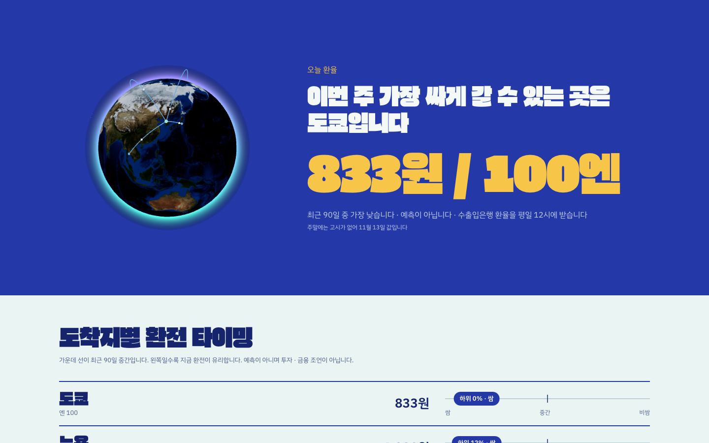
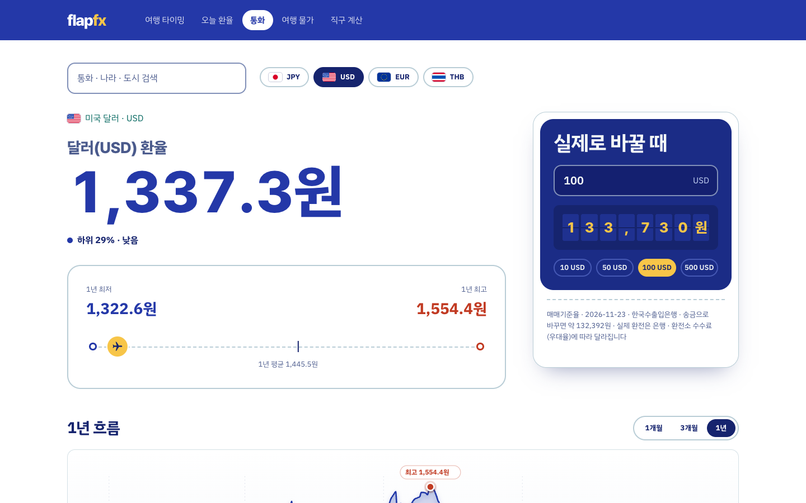
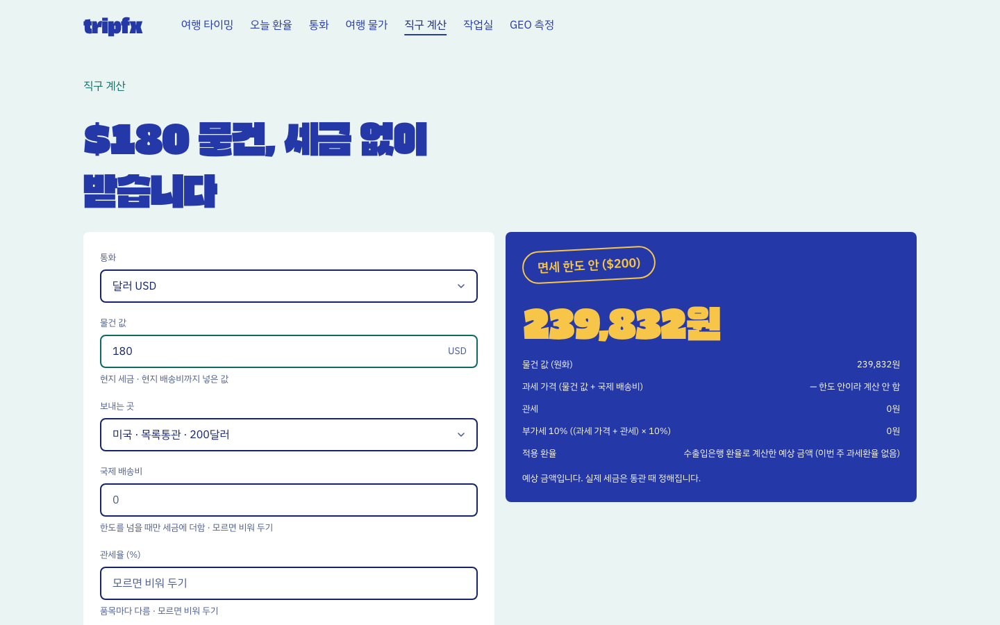
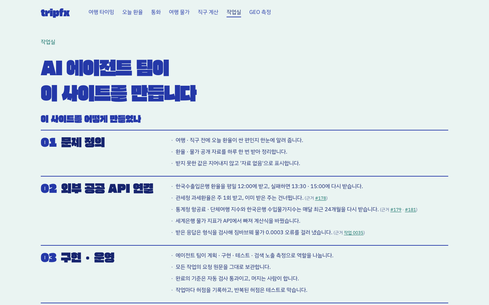
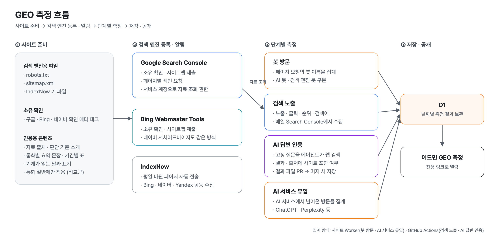

<div align="center">

# 💱 Flapfx

**AI 코딩 에이전트를 활용한 서비스 개발 · 운영 학습 프로젝트**

개인 프로젝트 · 기획 · 설계 · 검증 담당 (구현 · 운영은 AI 에이전트) · 2026.10 ~

[🌐 flapfx.com](https://flapfx.com) · [🛠️ 작업실](https://flapfx.com/log) · [📡 GEO 측정](https://flapfx.com/geo)

<br>


<br><br>

한국수출입은행 · 관세청 · 통계청 · 한국은행 · 세계은행 공개 데이터를 바탕으로 환율, 여행 타이밍(항공료 지수), 국가별 물가 수준, 직구 예상 세액을 제공하는 대시보드입니다.<br>
개발자는 기획 · 설계 · 검증을 담당하고, 구현 · 테스트 · 배포 · 운영 점검은 AI 코딩 에이전트(Claude Code · Codex)가 수행합니다.<br>
에이전트 팀(lead · builder · test · geo)은 <b>OpenRig</b>로 한 팀으로 띄우고, <b>Herdr</b>로 네 터미널을 한 화면에 나란히 띄워 진행을 지켜봅니다.<br>
에이전트의 작업 과정, 오류, 장애 대응 기록은 작업실 페이지에 공개합니다.

<br>

<table>
  <tr>
    <td></td>
    <td></td>
  </tr>
  <tr>
    <td></td>
    <td></td>
  </tr>
</table>

</div>

---

## 학습 주제

**🤖 에이전트 하네스** — 에이전트의 작업 완료 판정과 반복 오류를 검사 도구로 관리하는 방법을 학습했습니다.

**🧱 도메인 경계 · 컨텍스트 설계** — 기능 경계를 정의하고, 에이전트에게 맥락을 전달하는 구조를 설계했습니다.

**🔧 운영 · 장애 대응** — 운영 중 발생한 장애의 원인을 분석하고, 근거를 검토한 뒤 조치를 승인했습니다.

**⏱️ 예약 작업 설계** — 플랫폼별 동작 차이와 예약 실행 지연이 수집 · 배포에 미치는 영향을 검토했습니다.

**📡 GEO 실험** — 검색 엔진과 AI 검색에서 사이트의 노출 여부를 측정하는 방법을 설계하고, 이를 바탕으로 실험을 진행하고 있습니다.

아래 세부 내용은 위 주제와 같은 순서로 구성했습니다.

---

## 세부 내용

<details>
<summary><b>🤖 에이전트 하네스</b> — 완료 판정을 검사 도구에 맡기고, 반복 오류를 자동 검사로 전환</summary>

<br>

**배경** — 에이전트가 검증 없이 작업 완료를 보고하거나, 지시문에 명시한 규칙을 반복해서 위반하는 사례가 있었습니다.

**과정**
- 타입 검사 · 린트 · 테스트 · 보호 파일 · 작업 범위를 확인하는 게이트를 적용하고, 게이트 통과를 완료 조건으로 정의했습니다.
- 규칙 · 배포 설정 · 데이터 계약을 보호 파일로 지정하고, 개발자 승인 없이는 CI를 통과하지 않도록 했습니다.
- 응답 언어 규칙 위반과 작업 범위 밖 파일 쓰기는 훅으로 검사하도록 했습니다.
- 계획 · 통합(lead), 구현(builder), 테스트 먼저 작성(test), 검색 노출 측정(geo) 네 역할을 OpenRig로 한 팀으로 운영하고, 역할마다 고칠 수 있는 파일 범위를 나눴습니다. 진행은 Herdr로 네 터미널을 한 화면에 띄워 확인했습니다.
- 테스트는 통과했지만 실행 환경에서 동작하지 않은 스크립트 사례를 계기로, 스크립트가 타입 검사 대상에 포함되도록 했습니다.

**학습 내용**
- 반복되는 오류를 자동으로 검사하는 편이 지시문을 보완하는 것보다 재발 방지에 효과적이었습니다.
- 경계 테스트를 통해 병합 전에 에이전트가 잘못 배치한 파일을 발견했습니다.
- 소규모 수정에도 작업 기록과 게이트 통과가 필요해 작업 시간이 늘어났습니다.

</details>

<details>
<summary><b>🧱 도메인 경계 · 컨텍스트 설계</b> — 기능 단위 분리와 규칙 원본 관리, 요청 원문 전달 방식 적용</summary>

<br>

**배경** — 에이전트는 세션마다 맥락을 새로 파악해야 하며, 문서로만 정의한 기능 경계는 유지되지 않는 경우가 있었습니다.

**과정**
- 기능별 슬라이스(`features/<기능>/`)로 코드를 분리하고, 슬라이스 간 직접 참조를 금지했습니다.
- 업무 규칙은 `docs/domain/`에서 단일 원본으로 관리하고, 코드와 테스트는 규칙 ID로만 참조하도록 했습니다.
- 에이전트의 진입점을 50줄 이내의 `AGENTS.md`로 제한하고, 상세 문서는 링크로 연결했습니다.
- 작업별 요청 원문을 요약 없이 작업 폴더에 보관하여 이후 세션에서도 동일한 원문을 기준으로 작업을 이어 가도록 했습니다.

**학습 내용**
- 경계 규칙은 테스트와 린트로 강제할 때 유지되었습니다.
- 요청을 요약해서 전달하면 의도가 누락될 수 있어, 원문 전달을 원칙으로 정했습니다.

</details>

<details>
<summary><b>🔧 운영 · 장애 대응</b> — 화면상 정상으로 표시되던 장애 사례 분석과 점검 · 경고 방식 검토</summary>

<br>

**배경** — 수출입은행 데이터 수집에 실패한 후 4영업일 동안 예비 출처의 데이터를 사용했습니다. 이 기간에도 화면에는 상태가 정상으로 표시되어 장애를 뒤늦게 파악했습니다.

**과정**
- 코드 변경, 인증서, 플랫폼, 네트워크 경로 순으로 가설을 검증해 원인 범위를 좁혔습니다.
- 근본 원인(HTTP 525)은 은행 서버 로그를 확인할 수 없어 확정하지 못했고, 공식 데이터가 없으면 재시도하는 방어 로직을 적용했습니다.
- 상태 점검판이 예비 데이터만 있는 경우에도 정상으로 판정하는 문제를 확인하고, 해당 상태가 경고로 표시되도록 수정했습니다.
- AI 답변 측정 작업이 모든 질문에서 실패했는데도 성공으로 기록되는 문제를 확인하고, 실패 사유가 기록되도록 수정했습니다.

**학습 내용**
- 작업 실행 여부와 결과의 정상 여부는 별도로 확인해야 했습니다.
- 근본 원인이 확정되지 않은 상황에서도 영향 범위를 줄이는 방어 로직을 먼저 적용할 수 있었습니다.

</details>

<details>
<summary><b>⏱️ 예약 작업 설계</b> — 요일 해석 차이와 예약 실행 지연에 따른 수집 누락 사례 검토</summary>

<br>

**배경** — 예약 작업이 실행되지 않거나 예정 시각보다 몇 시간 늦게 실행된 사례가 있었습니다.

**과정**
- Cloudflare Cron이 요일 숫자 1을 일요일로 해석해 금요일 수집이 누락된 사례를 확인하고, 요일을 이름으로 표기하도록 변경했으며 숫자 표기를 금지하는 테스트를 추가했습니다.
- 배포 직후 예약 실행이 누락되는 경우에 대비해 재시도 예약을 추가하고, 예약 직전에는 배포가 지연되도록 했습니다.
- GitHub Actions 예약 작업이 다음 날로 지연되어 전날 변경된 페이지의 색인 요청이 누락된 사례를 확인하고, 전송 범위를 전날까지 확대했습니다.

**학습 내용**
- 동일한 설정도 플랫폼마다 해석이 다를 수 있어, 플랫폼별로 기대하는 동작을 테스트로 명시할 필요가 있었습니다.
- 날짜와 시각에 의존하는 로직은 실행 지연과 누락을 전제로 설계해야 했습니다.

</details>

<details>
<summary><b>📡 GEO 실험</b> — 등록 · 색인 · 노출 · 인용 단계별 측정 방법 설계 (진행 중)</summary>

<br>

**배경** — 검색 엔진에 등록한 뒤에도 검색 결과와 AI 답변에 사이트가 노출되지 않았습니다.

**과정**
- 봇 방문, 검색 노출, AI 답변 인용, AI 서비스 유입의 단계로 나눠 측정하고, 측정 결과를 페이지로 공개했습니다.
- 자료 출처와 판단 기준을 명시하고 요약 문장과 기간별 표를 추가했습니다. 변경된 페이지의 색인 요청도 자동화했습니다.
- 요약 문장과 표는 통화의 절반에만 적용해, 적용 여부에 따른 차이를 비교할 수 있도록 했습니다.
- AI 검색 API 측정이 비용 문제로 중단된 뒤, 에이전트 세션이 직접 검색하고 결과를 PR로 기록하는 방식으로 변경했습니다.

**학습 내용**
- 등록, 색인, 노출, 인용은 단계별로 구분하여 측정해야 했습니다.
- 측정 방법은 비용을 포함해 지속 가능성을 고려해야 했습니다.
- 현재 노출 초기 단계이며, 미노출 원인을 조사하고 있습니다.

</details>

<details>
<summary><b>⚙️ 자동으로 도는 일</b> — GitHub Actions 워크플로 11개의 역할과 실행 시점</summary>

<br>

[Actions](https://github.com/kyungchan3007/agents-auto-web/actions) 화면에는 사람이 올린 PR 검사와 예약 작업이 함께 보입니다. 이름 앞의 분류로 구분합니다.

**검사**
- `checks.yml` 자동 검사 — PR과 main에 올라올 때마다 타입 · 린트 · 테스트 · 보호 파일 · 작업 범위를 확인합니다. 통과해야 머지할 수 있습니다.
- `responsive.yml` 운영 화면 크기별 확인 — 머지 뒤와 매일 12:40에 운영 사이트를 세 브라우저 엔진, 네 가지 화면 폭으로 엽니다.
- `security-audit.yml` 매일 보안 점검 — 매일 05:30에 의존성 취약점을 확인하고, 고칠 것이 있으면 이슈를 엽니다.

**배포**
- `deploy-api.yml` API 배포 — main 검사가 통과하고 API가 바뀐 경우에만 배포합니다.
- `rebuild-site.yml` 사이트 다시 만들기 — 평일 12:30, 환율 수집 30분 뒤에 사이트를 새 데이터로 다시 만듭니다.
- `release-web.yml` 운영 릴리스 만들기 — 운영 사이트 버전이 main 에 올라가면 `web-v<버전>` 태그와 GitHub 릴리스를 만듭니다. 버전과 변경 기록은 Changesets 로 정합니다.

**수집 · 알림 · 기록**
- `ensure-fx.yml` 오늘 환율 빠짐 보충 — 평일 12:10~17:40에 30분마다 오늘 환율이 있는지 보고, 없으면 수집을 다시 요청합니다.
- `gsc-sync.yml` 검색 노출 기록 — 매일 04:20에 Search Console 노출 · 클릭 기록을 저장합니다.
- `ig-insights.yml` 인스타 성과 기록 — 매일 04:40에 인스타 게시물 · 계정 성과(도달 · 좋아요 · 저장 · 공유 · 조회 등)를 저장합니다.
- `geo-ask.yml` AI 답변 인용 측정 기록 — 측정 결과 파일이 머지되면 저장합니다.
- `indexnow.yml` 바뀐 주소 알림 — 평일 16:00에 그날 바뀐 페이지를 검색 엔진에 알립니다.
- `sync-tasks.yml` 이슈 · PR 목록 동기화 — 머지와 이슈 변경을 사이트의 작업실 화면에 반영합니다.

시각은 모두 한국 시간입니다. PR 검사에서 실패한 기록은 테스트를 먼저 작성하고 실패를 확인하는 작업 방식에 따른 것입니다.

</details>

---

## 🏗️ 아키텍처

- **API (Cloudflare Workers)** — 환율 · 물가 데이터의 예약 수집과 D1 저장을 담당하며 조회 API를 제공합니다.
- **사이트 (Cloudflare Workers)** — 빌드 시 API 데이터로 정적 페이지를 생성해 Worker 정적 자산으로 올리며, 새 환율이 저장되면 다시 빌드됩니다.
- **BFF (사이트 Worker)** — 작업실의 실시간 조회 요청을 같은 주소의 `/bff` 경로에서 받아 서비스 바인딩으로 API를 호출합니다.
- **GitHub** — 에이전트의 변경 사항은 PR에서 게이트와 개발자 검증을 거쳐 병합됩니다. Actions는 보안 점검 · 검색 자료 수집 · 색인 요청을 수행합니다.


---

## 📡 GEO 측정 흐름

- **사이트 준비** — robots.txt · sitemap.xml · IndexNow 키 파일, 구글 · Bing 소유 확인 태그, 인용용 콘텐츠(통화 절반만 적용한 비교군 포함)
- **검색 엔진 등록 · 알림** — Google Search Console · Bing Webmaster Tools에 등록하고, 평일마다 바뀐 페이지를 IndexNow로 전송
- **단계별 측정** — 봇 방문, 검색 노출, AI 답변 인용, AI 서비스 유입을 나눠 측정
- **저장 · 공개** — 측정 결과를 D1에 날짜별로 보관하고 [GEO 측정 페이지](https://flapfx.com/geo)에 공개



---

## ⚖️ 기술 선택과 비용 검토

| 결정 | 비교 | 선택 |
| --- | --- | --- |
| 화면 렌더링 | Workers SSR vs 정적 생성 + BFF | 정적 생성 + BFF (Pages → Workers 정적 자산으로 옮김 · 2026-11-17) |
| 데이터베이스 | PostgreSQL vs D1(SQLite) + Drizzle | D1 + Drizzle |
| 브라우저의 API 호출 | API 직접 호출 vs 같은 주소의 BFF | BFF (서비스 바인딩) |
| 환율 수집 실행 | GitHub Actions 예약 vs Worker Cron | Worker Cron · Actions는 예비 |
| 작업 기록 수집 | Pages 빌드 중 GitHub API 호출 vs Actions가 D1에 저장 | Actions → D1 |
| AI 답변 측정 | AI 검색 API 자동 측정 vs 에이전트 세션 직접 검색 | 세션 측정 |
| 주소 | 개인 도메인 vs Cloudflare 무료 주소 | 무료 주소 |

> **렌더링 · 주소** — 데이터가 하루 한 번 바뀌는 서비스여서 정적 생성으로 충분했습니다. SSR로 전환하면 Workers로 옮겨 주소가 바뀌기 때문에, 무료 주소와 정적 화면을 유지하고 실시간 조회가 필요한 작업실만 BFF로 처리했습니다. 도메인은 구입 후 연결만 변경하면 되도록 했습니다.

> **D1 읽기 한도** — 무료 요금제의 하루 읽기 한도를 반복된 사이트 빌드로 초과하여 API가 오류를 반환한 사례가 있었습니다. 기본 키 순서(날짜, 통화) 때문에 한 통화를 조회해도 전체를 읽는 구조였고, (통화, 날짜) 색인을 추가했습니다. 이후 API 응답 캐시를 적용하고 빌드 횟수를 관리했습니다.

> **예약 실행 위치** — GitHub Actions 예약은 몇 시간씩 지연될 수 있어, 정시 수집은 Worker Cron이 맡고 Actions는 예비 실행만 맡도록 했습니다. 작업 기록 수집은 Pages 빌드 서버의 IP 공유로 GitHub API가 403을 반환해, Actions가 D1에 저장하는 방식으로 변경했습니다.

---

## 🧰 기술 스택

| 영역 | 기술 |
| --- | --- |
| 사이트 | Next.js 16 (정적 내보내기) · React · TypeScript · Tailwind CSS · three.js |
| API | Hono · Cloudflare Workers · Zod |
| 데이터 | Cloudflare D1 · Drizzle ORM |
| 배포 · 자동화 | Cloudflare Workers(정적 자산 + Worker) · Workers Builds · GitHub Actions · Turborepo |
| 검증 | Vitest · Playwright |
| 국기 그림 | country-flag-icons (MIT License) — 서버에서 SVG 로 그려 HTML 에 넣음 |
| AI 에이전트 | Claude Code · Codex · OpenRig(에이전트 팀) · Herdr(터미널 한 화면) |

---

## 폴더 구조

```text
apps/web        사이트 (Next.js 정적 내보내기)
apps/api        API (Hono · Workers · D1 · Drizzle)
packages/ui     디자인 시스템 · 3D
packages/shared 공용 타입 · zod 스키마
apps/web/worker 동일 주소의 /bff/* · 방문 기록
docs            구조 · 디자인 · 기능별 규칙
.agents         게이트 · 보호 파일 목록 · 작업 폴더
```

<div align="center">

MIT License

</div>
